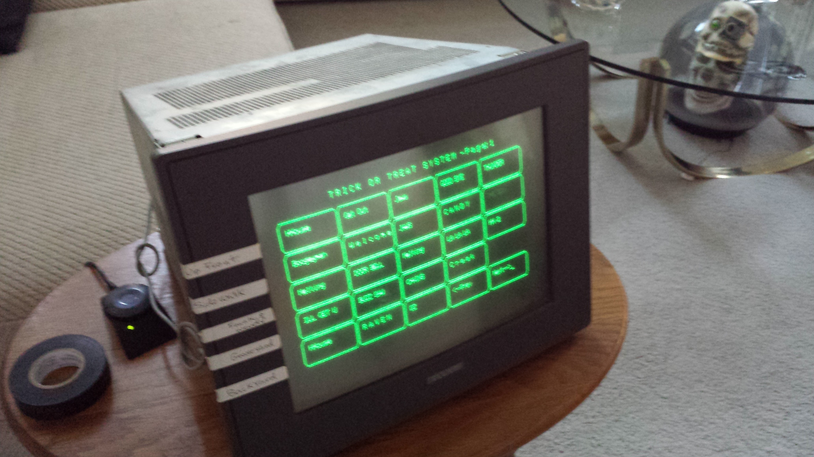

# Trick Or Treat Sound Effects Console
### Prototype program for new TOT device using R-Pi, touch screen. Replacing RS-232 terminal.  
  
The Fluke 1020 was one of the first industrial touch-screen monitors the came out in the mid-80s. With a touch-pad resolution about the size of a fingertip, the screen has 120 touch zones of 12 rows by 10 columns.

The new console software will also replace the Raspberry Pi software that is used to host and execute sound effects and visual effects for halloween. The current software is sometimes called ToT for trick-or-treat and may be referenced by the ToT abbreviation from time to time. The current ToT software is written in Python 3.x

## Current Operation
A sound effect is started by touching keys on the Fluke serial monitor. Touch escape seqences are then sent to the Raspberry Pi, interpreted, and sounds are played through the Pi 3.5mm audio interface. Other GPIO relays and external commands can be issued to execute custom audio-visual effects. (Strobe lights and other light controls are coneected with MQTT)

## New Program Goals          
- Use Kivy to design button-oriented application
- Program will be run and accessed over VNC with the new python applicaion in Kivy running on the Raspberry Pi host.
- User interface will be accessed through an VNC client on an iPad or other modern toudh device.
- Uses a json file to define the buttons and sounds to be played.

