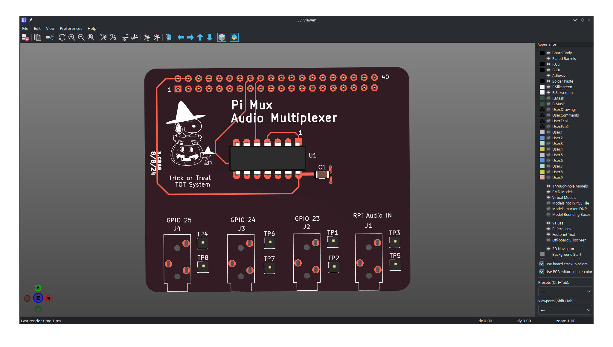
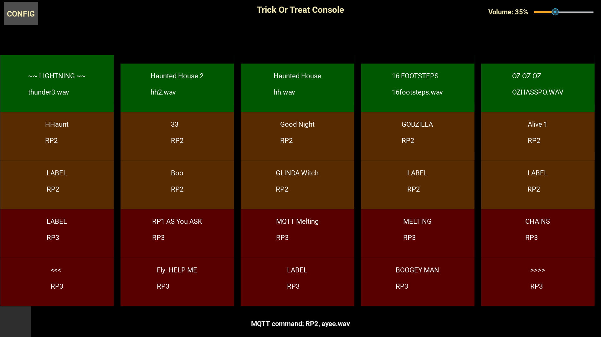

# Trick Or Treat Sound Effects Console
### Prototype program for new TOT device using R-Pi, touch screen. Replacing RS-232 terminal.  
  
The Fluke 1020 was one of the first industrial touch-screen monitors the came out in the mid-80s. With a touch-pad resolution about the size of a fingertip, the screen has 120 touch zones of 12 rows by 10 columns.


The new console software will also replace the Raspberry Pi software that is used to host and execute sound effects and visual effects for halloween. The current software is sometimes called ToT for trick-or-treat and may be referenced by the ToT abbreviation from time to time. The current ToT software is written in Python 3.x

## Current Operation
A sound effect is started by touching keys on the Fluke serial monitor. Touch escape seqences are then sent to the Raspberry Pi, interpreted, and sounds are played through the Pi 3.5mm audio interface. Other GPIO relays and external commands can be issued to execute custom audio-visual effects. (Strobe lights and other light controls are connected with MQTT)

## New Program Goals          
- Use Kivy to design button-oriented application
- Wanted to use VNC, but my Pi's are too slow and Kivy looks terrible through it. (Some drawing, graphics issues)
- User interface will be either a tethered solution with a HDMI touch screen or with a wireless protocol.
- Uses a json file to define the buttons and sounds to be played.

## New Platform, Same Goal
We have access to a Pi 500 which is fast enough to run the Kivy environment. The Pi 3A+ was a bit too slow. Pi 500 is connected to an Acer 15" touchscreen.

We were going to have the 500 communicate to the 3A+ with bluetooth or USB connections, but with the new WiFi 6 and the gamma mqtt server directly on the LAN, the MQTT delays seem bearable now.

The current speaker configuration depends solely on the Pi Audio Switcher HAT that sits on the Pi 3A+ 


The HAT only has 3 3.5mm outputs, so we will have 3 speakers. 1. The soundbar under the window bench, 2. Bose Mini Sound for the sidewalk and 3. Soundcore Mini for the front.


## Kivy Implemented on Acer 15" Touchscreen

We have a json file to hold all the button data. There are two ways to change the data, 1. Use the config button at the top of the screen to access the button config dialog (F1), 2. Edit the csv data as a spreadsheet.

Also added a volume control to have as sound monitor that we have been needing for a long time. We play the sound out of the 500's HDMI and command same sound via MQTT on the 3A+

## Created tot_jv.py
Program converts the button json data to csv and back to have a more convenient way to edit and visulize the data.
```
# to csv
python tot_jv.py -cc tot_test.json sc.csv

# to json
python tot_jv.py -cj sc.csv tot_test2.json
```

## Mixer Update
We had become pretty dependant on the fact that the Pi supports playing multiple sounds at a time when on the same speaker. Thsi mixing effect is really cool as you can press multiple buttons quickly and overlay sounds. We modified the TPI MQTT program to not clear the channel after each sound since it runs all the sounds not and not the Pi-1020 system.

The Pi 500 somehow became updated with an internal update (not in the UV environment) so we had to switch audio player to mpv which uses PipeWire for audio.
```
os.system('mpv --no-video --ao=pulse ' + sfxpath + mpayload + '&')
```
